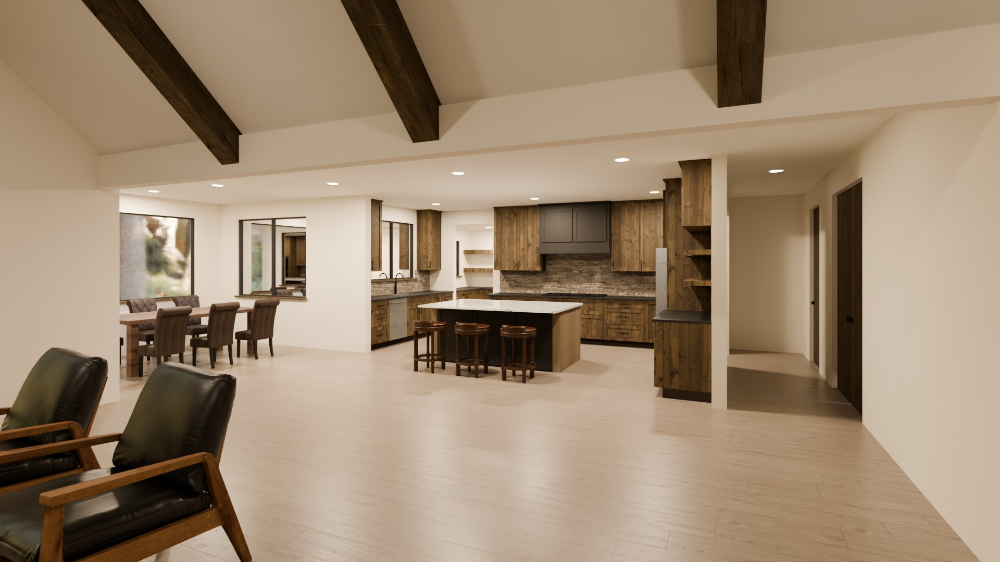
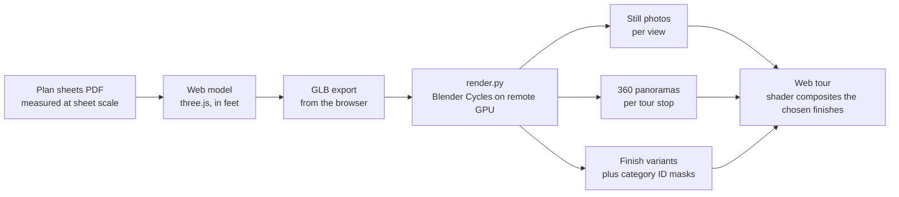
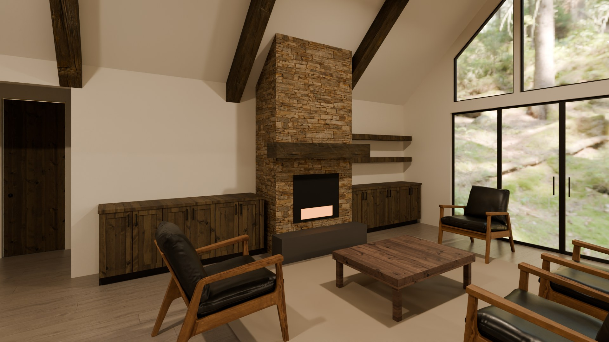

# From Paper Plans to a Photoreal 360 Home Tour

**A 3D model of a custom home under construction, built from the architect's plan sheets, rendered photoreal in Blender Cycles on a remote GPU, and delivered as a browser-based 360 tour where the owners can swap finishes live.**

The owners of a custom home under construction had a stack of plan sheets and a few finish samples to go on. Flat drawings make it hard to picture a vaulted great room with exposed beams, or to choose a countertop without seeing it next to the cabinets. So I built a walkthrough: stand in the kitchen, look around in 360 degrees, and flip between finish options to see the room change.

This repo is the engineering writeup. The owners, the location and the plan sheets stay private, so it contains only my own renders and no source documents.

---

## By the numbers

| Metric | Value |
|---|---|
| Rooms modeled | Kitchen, great room, foyer, dining |
| Source | Architect plan sheets (PDF), measured at the sheet's own scale |
| Web model | About 1,200 lines of JavaScript (three.js) |
| Render pipeline | Blender Cycles, driven by a 334-line Python script |
| GPU | Remote desktop RTX 2070 Super, driven over SSH |
| 360 tour | 9 stops, equirectangular panoramas |
| Finish categories | 10 (cabinets, countertops, backsplash, floor, beams and more) |
| Finish variant files | 117 published for the as-built version |
| Textures and furniture | CC0 assets from Poly Haven and ambientCG |

## Architecture

Three stages: **model, render, composite.** The browser model is the source of truth for geometry, Blender is only the camera, and the tour does the finish swapping without re-rendering anything.

## Engineering highlights

### 1. Plans to geometry at real scale
The plan sheets are vector PDFs. I measured walls, openings, the island and the cabinet runs straight off the sheet at its own scale, so every dimension in the model traces back to a drawing. When two sheets disagreed (a decorative beam on the floor plan that the beam schedule never lists), the model follows the more specific sheet, and the render script drops that beam by default with a flag to put it back.

### 2. One model, two engines
The web model is built in three.js in feet with y up. Blender works in meters with z up, and the furniture assets are in meters too. A small conversion layer in `render.py` maps axes and units once, so the same GLB drives both the quick browser preview and the photoreal render. The script also re-assigns materials after import: the web model lumps beams, doors and sills onto one material, and the render splits them so only the beams get the distressed wood finish.

### 3. Photoreal rendering as a batch job
`render.py` runs headless (`blender -b -P render.py -- ...`) and takes flags for views, sample count, resolution, exposure, time of day and design variants (for example, with or without a wall-mounted TV). It picks the GPU automatically and renders on a desktop over SSH, so a laptop can kick off a full re-render and collect the results. Windows get light portals so interior lighting converges at reasonable sample counts.

### 4. Live finish swapping without re-rendering
Rendering every combination of 10 finish categories is impossible. Instead, each finish option is rendered once per tour stop, along with an ID mask that labels every pixel by category (cabinets, countertop, beams and so on). In the browser, a shader reads the mask and composites the chosen option for each category, blending the four nearest mask texels so edges stay smooth. Picking a new countertop is instant, and adding an option means one new look and one more render pass, not a combinatorial explosion.

### 5. Tuning for realism
- **Exposure:** the dark stained cabinets washed out at high exposure, so exposure was tuned until the stain read true to the sample.
- **Panorama placement:** 360 cameras distort anything close, so every tour stop keeps about 3 feet of clearance from furniture.
- **Details from the real selections:** cabinet wood, stain, painted finishes and beam sizes all come from the owners' actual choices and the beam schedule, so the renders show the house being built, not a generic one.

## What I'd do next
- Finish the remaining selections (countertops, paint, hardware) as they get picked, so the tour stays a live decision tool through construction.
- Add an evening lighting pass for every stop.
- Package the plans-to-tour pipeline so it works for any floor plan, not just this one.

## Tools
three.js, Blender 5 (Cycles), Python, JavaScript, GLSL, SSH, Poly Haven and ambientCG (CC0 assets). Built solo, with Claude Code as a coding partner.
